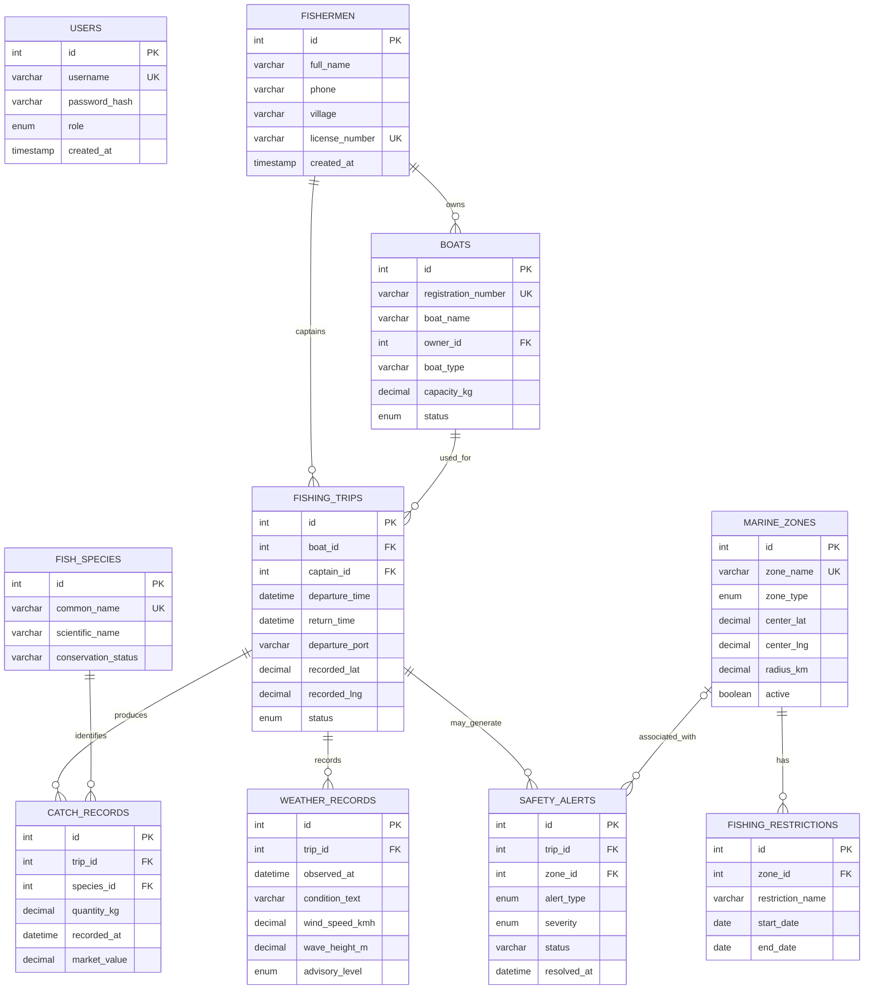

# Entity–Relationship Diagram

This document describes the relational structure defined in `sql/schema.sql`. The diagram is written in Mermaid and can be rendered by GitHub.

## ER diagram

`USERS` is an independent authentication entity. The other relationships are enforced through foreign keys in the schema.

## Relationship summary

| Parent | Child | Cardinality | Foreign key |
|---|---|---|---|
| `fishermen` | `boats` | One-to-many | `boats.owner_id` |
| `fishermen` | `fishing_trips` | One-to-many (captain) | `fishing_trips.captain_id` |
| `boats` | `fishing_trips` | One-to-many | `fishing_trips.boat_id` |
| `marine_zones` | `fishing_restrictions` | One-to-many | `fishing_restrictions.zone_id` |
| `fishing_trips` | `catch_records` | One-to-many | `catch_records.trip_id` |
| `fish_species` | `catch_records` | One-to-many | `catch_records.species_id` |
| `fishing_trips` | `weather_records` | One-to-many | `weather_records.trip_id` |
| `fishing_trips` | `safety_alerts` | One-to-many | `safety_alerts.trip_id` |
| `marine_zones` | `safety_alerts` | One-to-many, optional on alert | `safety_alerts.zone_id` |

## Notes

- Every table uses a surrogate integer primary key.
- Boat ownership and trip assignments are linked to fishermen; a fisherman can own boats and can also captain trips.
- Catch rows connect a trip to a fish species and store quantity and estimated value.
- An alert must refer to a trip. Its zone reference is optional and becomes `NULL` if the referenced zone is deleted (`ON DELETE SET NULL`).
- The SQL schema restricts deletion of fishermen, boats, zones and species when dependent records exist. Catch, weather and alert rows are configured to cascade when their parent trip is deleted.
- `users` is not linked to operational records in the current schema.
